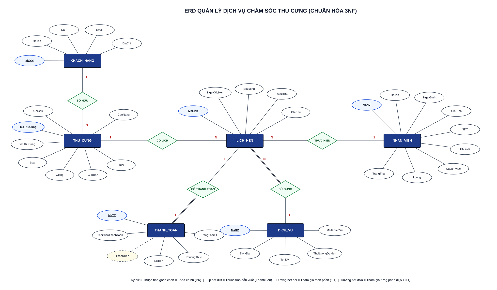
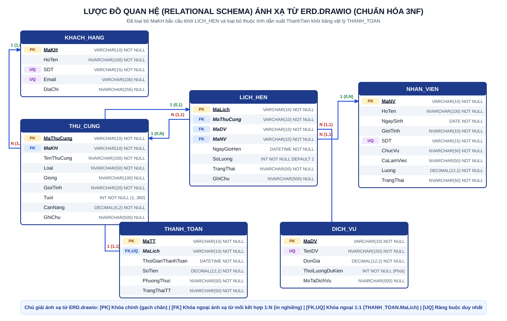
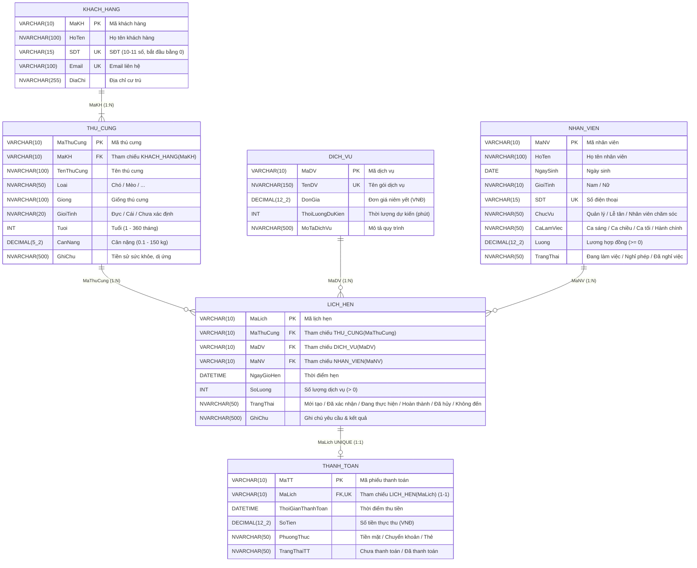

# 🐾 HỆ THỐNG CƠ SỞ DỮ LIỆU QUẢN LÝ DỊCH VỤ CHĂM SÓC THÚ CƯNG (PETCARE SPA & CLINIC)

> **Đồ án / Bài tập lớn Học phần Cơ sở dữ liệu (Database Management Systems)**  
> Thiết kế chuẩn hóa 3NF/BCNF, kiểm soát toàn vẹn dữ liệu & quy tắc nghiệp vụ, tra cứu đa tiêu chí và xuất báo cáo quản trị thực tế.

---

## 📑 Mục lục
1. [Tiêu đề và Mô tả bài toán](#-1-tiêu-đề-và-mô-tả-bài-toán)
2. [Thiết kế Cơ sở dữ liệu (Database Design)](#-2-thiết-kế-cơ-sở-dữ-liệu-database-design)
   - [2.1. Biểu đồ Thực thể - Liên kết (ERD)](#21-biểu-đồ-thực-thể---liên-kết-erd)
   - [2.2. Lược đồ Quan hệ (Relational Schema)](#22-lược-đồ-quan-hệ-relational-schema)
   - [2.3. Chuẩn hóa dữ liệu (1NF đến 3NF / BCNF)](#23-chuẩn-hóa-dữ-liệu-1nf-đến-3nf--bcnf)
3. [Công nghệ sử dụng](#-3-công-nghệ-sử-dụng)
4. [Danh sách tính năng & Truy vấn nâng cao](#-4-danh-sách-tính-năng--truy-vấn-nâng-cao)
5. [Hướng dẫn cài đặt và Khởi tạo dữ liệu (Setup)](#-5-hướng-dẫn-cài-đặt-và-khởi-tạo-dữ-liệu-setup)
6. [Cấu hình kết nối (Database Configuration)](#-6-cấu-hình-kết-nối-database-configuration)
7. [Thành viên thực hiện](#-7-thành-viên-thực-hiện)

---

## 📌 1. Tiêu đề và Mô tả bài toán

### 1.1. Tên đồ án
**Hệ thống Cơ sở dữ liệu Quản lý Dịch vụ Chăm sóc Thú cưng (PetCare Spa & Clinic)**

### 1.2. Bối cảnh và Yêu cầu thực tế
Hiện nay nhu cầu nuôi thú cưng (chó, mèo, thú cảnh) phát triển mạnh, kéo theo sự gia tăng nhanh chóng của các dịch vụ chăm sóc chuyên nghiệp như tắm vệ sinh tiêu chuẩn, cắt tỉa lông nghệ thuật (*Grooming*), spa ủ dưỡng lông, vệ sinh răng miệng và lưu trú khách sạn thú cưng. Khi số lượng khách hàng, hồ sơ thú cưng và lịch hẹn tăng lên hằng ngày, phương thức quản lý thủ công bằng sổ sách hoặc bảng tính rời rạc dễ dẫn đến:
- **Trùng lịch phân công kỹ thuật viên** hoặc phân công nhầm nhân viên đang nghỉ phép / trái ca làm việc.
- **Thất lạc thông tin tiền sử sức khỏe, dị ứng** của thú cưng (dị ứng sữa tắm, bệnh lý da, tính cách nhát người...).
- **Dư thừa và không nhất quán dữ liệu** giữa chủ sở hữu, thú cưng, lịch hẹn và hóa đơn thanh toán.
- **Khó khăn khi tổng hợp và đối soát doanh thu** theo từng gói dịch vụ, phương thức thanh toán (Tiền mặt, Chuyển khoản, Thẻ) và đánh giá hiệu suất làm việc (KPI) của nhân viên cuối kỳ.

### 1.3. Mục tiêu quản lý của hệ thống
Hệ thống được xây dựng nhằm quản lý tập trung, nhất quán và tự động hóa 6 quy trình nghiệp vụ cốt lõi:
1. **Quản lý Khách hàng (`KHACH_HANG`):** Lưu trữ thông tin định danh chủ nuôi, số điện thoại duy nhất, email và địa chỉ để tra cứu nhanh tại quầy lễ tân.
2. **Quản lý Hồ sơ Thú cưng (`THU_CUNG`):** Quản lý danh sách thú cưng gắn với từng chủ sở hữu, lưu rõ loài, giống, giới tính, tuổi (tháng), cân nặng (kg) và ghi chú đặc điểm sức khỏe/dị ứng.
3. **Quản lý Danh mục Dịch vụ & Bảng giá (`DICH_VU`):** Chuẩn hóa mã dịch vụ, tên gói dịch vụ, đơn giá niêm yết, thời lượng thực hiện dự kiến (phút) và quy trình chi tiết.
4. **Quản lý Nhân sự & Phân ca (`NHAN_VIEN`):** Theo dõi hồ sơ nhân viên (Quản lý, Lễ tân, Nhân viên chăm sóc), ca làm việc cố định, mức lương và trạng thái làm việc.
5. **Tiếp nhận, Đặt lịch hẹn & Điều phối kỹ thuật viên (`LICH_HEN`):** Ghi nhận lịch hẹn chăm sóc thú cưng, tự động kiểm tra ca làm việc, trạng thái nhân viên và chống trùng lịch trong khung giờ thực hiện.
6. **Quản lý Thanh toán & Báo cáo thống kê (`THANH_TOAN`):** Quản lý giao dịch thu ngân (1-1 với lịch hẹn hoàn thành), phân loại theo phương thức thanh toán và kết xuất báo cáo doanh thu / hiệu suất nhân sự ra Excel (`.xlsx`), Word (`.doc`), CSV, PDF.

---

## 🗄️ 2. Thiết kế Cơ sở dữ liệu (Database Design)

### 2.1. Biểu đồ Thực thể - Liên kết (ERD)

Sơ đồ ERD được thiết kế và chuẩn hóa theo **ký hiệu Chen** trong file [`ERD.drawio`](./ERD.drawio), bao gồm **6 tập thực thể** và **5 mối kết hợp** (`SỞ HỮU`, `CÓ LỊCH`, `THỰC HIỆN`, `SỬ DỤNG`, `CÓ THANH TOÁN`):
- **Không vẽ thuộc tính khóa ngoại (FK) trên ERD:** Ở mức quan niệm (`ERD.drawio`), các thực thể chỉ chứa thuộc tính nội tại của chính thực thể đó (đã loại bỏ hoàn toàn các hình elip khóa ngoại và mối kết hợp vòng dư thừa `ĐẶT` giữa `KHACH_HANG` và `LICH_HEN` ở bản ERD cũ).
- **Ký hiệu chuẩn Chen:** Thuộc tính khóa chính được **gạch chân** (`MaKH`, `MaThuCung`, `MaLich`, `MaNV`, `MaDV`, `MaTT`), thuộc tính dẫn xuất `ThanhTien` trên thực thể `THANH_TOAN` được vẽ bằng **hình elip nét đứt**, nhánh tham gia toàn phần `(1,1)` vẽ bằng **đường nét đôi**, nhánh tham gia từng phần `(0,N)` / `(0,1)` vẽ bằng **đường nét đơn**.



#### Danh sách Thực thể & Mối kết hợp trên `ERD.drawio`
| Tập thực thể trên `ERD.drawio` | Các thuộc tính gốc trên ERD (Ký hiệu Chen) | Mối kết hợp tham gia |
| :--- | :--- | :--- |
| **`KHACH_HANG`** (5 thuộc tính) | $\underline{\text{MaKH}}$, HoTen, SDT, Email, DiaChi | `KHACH_HANG` $(1)$ — **SỞ HỮU** $\text{==}$ $(N)$ `THU_CUNG` |
| **`THU_CUNG`** (8 thuộc tính) | $\underline{\text{MaThuCung}}$, TenThuCung, Loai, Giong, GioiTinh, Tuoi, CanNang, GhiChu | **SỞ HỮU** $(N)$, và `THU_CUNG` $(1)$ — **CÓ LỊCH** $\text{==}$ $(N)$ `LICH_HEN` |
| **`LICH_HEN`** (5 thuộc tính) | $\underline{\text{MaLich}}$, NgayGioHen, SoLuong, TrangThai, GhiChu | **CÓ LỊCH** $(N)$, **THỰC HIỆN** $(N)$, **SỬ DỤNG** $(N)$, **CÓ THANH TOÁN** $(1)$ |
| **`NHAN_VIEN`** (9 thuộc tính) | $\underline{\text{MaNV}}$, HoTen, NgaySinh, GioiTinh, SDT, ChucVu, CaLamViec, Luong, TrangThai | `LICH_HEN` $(N)$ $\text{==}$ **THỰC HIỆN** — $(1)$ `NHAN_VIEN` |
| **`DICH_VU`** (5 thuộc tính) | $\underline{\text{MaDV}}$, TenDV, DonGia, ThoiLuongDuKien, MoTaDichVu | `LICH_HEN` $(N)$ $\text{==}$ **SỬ DỤNG** — $(1)$ `DICH_VU` |
| **`THANH_TOAN`** (5 thuộc tính + 1 dẫn xuất) | $\underline{\text{MaTT}}$, ThoiGianThanhToan, *ThanhTien (elip nét đứt)*, SoTien, PhuongThuc, TrangThaiTT | `LICH_HEN` $(1)$ — **CÓ THANH TOÁN** $\text{==}$ $(1)$ `THANH_TOAN` |

---

### 2.2. Lược đồ Quan hệ (Relational Schema)

Lược đồ quan hệ dưới đây đã được **cập nhật và ánh xạ trực tiếp 100% từ file [`ERD.drawio`](./ERD.drawio) mới nhất** (đồng bộ hoàn toàn với bố cục không gian của `ERD.drawio` và file [`csdl_cham_soc_thu_cung.sql`](./csdl_cham_soc_thu_cung.sql)):



#### Quy tắc ánh xạ từ `ERD.drawio` mới sang Lược đồ Quan hệ (So với ERD cũ trước đây)
1. **Ánh xạ 4 mối kết hợp `1 : N` thành Khóa ngoại (`FOREIGN KEY NOT NULL`):**
   - Mối kết hợp **SỞ HỮU** (`KHACH_HANG` $1 - N$ `THU_CUNG`): Sinh ra khóa ngoại `MaKH` (`NOT NULL`) trong bảng `THU_CUNG`.
   - Mối kết hợp **CÓ LỊCH** (`THU_CUNG` $1 - N$ `LICH_HEN`): Sinh ra khóa ngoại `MaThuCung` (`NOT NULL`) trong bảng `LICH_HEN`. *(Đã xóa bỏ cột `MaKH` dư thừa trong bảng `LICH_HEN` của ERD cũ vì đã bỏ mối kết hợp vòng `ĐẶT`)*.
   - Mối kết hợp **SỬ DỤNG** (`DICH_VU` $1 - N$ `LICH_HEN`): Sinh ra khóa ngoại `MaDV` (`NOT NULL`) trong bảng `LICH_HEN`.
   - Mối kết hợp **THỰC HIỆN** (`NHAN_VIEN` $1 - N$ `LICH_HEN`): Sinh ra khóa ngoại `MaNV` (`NOT NULL`) trong bảng `LICH_HEN`.
2. **Ánh xạ mối kết hợp `1 : 1` (**CÓ THANH TOÁN** giữa `LICH_HEN` và `THANH_TOAN`):**
   - Do nhánh `THANH_TOAN` tham gia toàn phần (đường nét đôi $\text{==}$ trên `ERD.drawio`), khóa chính `MaLich` của `LICH_HEN` được đưa vào bảng `THANH_TOAN` làm Khóa ngoại kết hợp ràng buộc duy nhất (`FOREIGN KEY`, `UNIQUE`, `NOT NULL`).
3. **Xử lý thuộc tính dẫn xuất `ThanhTien` (Elip nét đứt trên `ERD.drawio`):**
   - Thuộc tính dẫn xuất `ThanhTien` trên thực thể `THANH_TOAN` không tạo thành cột vật lý trong bảng `THANH_TOAN` (tránh dư thừa dữ liệu), mà được tính tự động qua công thức `DonGia * SoLuong` khi kết nối bảng.

#### Đặc tả 6 quan hệ trong Lược đồ Quan hệ (Chuẩn 3NF)
1. **`KHACH_HANG`** ($\underline{\text{MaKH}}$, HoTen, SDT, Email, DiaChi) — *5 thuộc tính*
2. **`THU_CUNG`** ($\underline{\text{MaThuCung}}$, *MaKH*, TenThuCung, Loai, Giong, GioiTinh, Tuoi, CanNang, GhiChu) — *9 thuộc tính (8 thuộc tính gốc + 1 FK `MaKH`)*
   - Khóa ngoại: `MaKH` $\rightarrow$ `KHACH_HANG(MaKH)`
3. **`LICH_HEN`** ($\underline{\text{MaLich}}$, *MaThuCung*, *MaDV*, *MaNV*, NgayGioHen, SoLuong, TrangThai, GhiChu) — *8 thuộc tính (5 thuộc tính gốc + 3 FK `MaThuCung`, `MaDV`, `MaNV`)*
   - Khóa ngoại: `MaThuCung` $\rightarrow$ `THU_CUNG(MaThuCung)`, `MaDV` $\rightarrow$ `DICH_VU(MaDV)`, `MaNV` $\rightarrow$ `NHAN_VIEN(MaNV)`
4. **`NHAN_VIEN`** ($\underline{\text{MaNV}}$, HoTen, NgaySinh, GioiTinh, SDT, ChucVu, CaLamViec, Luong, TrangThai) — *9 thuộc tính*
5. **`DICH_VU`** ($\underline{\text{MaDV}}$, TenDV, DonGia, ThoiLuongDuKien, MoTaDichVu) — *5 thuộc tính*
6. **`THANH_TOAN`** ($\underline{\text{MaTT}}$, *MaLich* (UNIQUE), ThoiGianThanhToan, SoTien, PhuongThuc, TrangThaiTT) — *6 thuộc tính (5 thuộc tính gốc + 1 FK 1-1 `MaLich`; đã lược bỏ `ThanhTien` dẫn xuất)*
   - Khóa ngoại 1-1: `MaLich` $\rightarrow$ `LICH_HEN(MaLich)`

#### Sơ đồ Lược đồ Quan hệ dạng Mermaid (`erDiagram`)


---

### 2.3. Chuẩn hóa dữ liệu (1NF đến 3NF / BCNF)

Toàn bộ 6 quan hệ trong CSDL đã được rà soát phụ thuộc hàm và chuẩn hóa triệt để từ **1NF $\rightarrow$ 2NF $\rightarrow$ 3NF / BCNF**:

| Mức chuẩn hóa | Nguyên tắc lý thuyết | Áp dụng thực tế trong Đồ án PetCare |
| :--- | :--- | :--- |
| **Chuẩn 1 (1NF)** | Mọi thuộc tính trong bảng đều chứa giá trị nguyên tố (*atomic*), không có thuộc tính lặp hay đa trị. | Tất cả các cột trong 6 bảng đều lưu giá trị đơn. Danh sách nhiều thú cưng của một khách hàng được tách thành các dòng độc lập trong bảng `THU_CUNG`; nhiều lần đặt lịch được tách thành các bản ghi trong `LICH_HEN`. |
| **Chuẩn 2 (2NF)** | Đạt 1NF và mọi thuộc tính không khóa đều phụ thuộc hàm đầy đủ vào khóa chính (không có phụ thuộc bộ phận vào một phần của khóa chính). | Toàn bộ 6 bảng (`KHACH_HANG`, `THU_CUNG`, `NHAN_VIEN`, `DICH_VU`, `LICH_HEN`, `THANH_TOAN`) đều sử dụng **khóa chính đơn** (`MaKH`, `MaThuCung`, `MaNV`, `MaDV`, `MaLich`, `MaTT`), do đó không tồn tại phụ thuộc hàm bộ phận $\Rightarrow$ **100% đạt 2NF**. |
| **Chuẩn 3 (3NF)** | Đạt 2NF và không tồn tại thuộc tính không khóa nào phụ thuộc bắc cầu (*Transitive Dependency*: $X \rightarrow Y \rightarrow Z$) vào khóa chính. | Đã phát hiện và **khử 2 phụ thuộc bắc cầu quan trọng** trong thiết kế sơ bộ:<br>1. **Tại bảng `LICH_HEN`:** Thiết kế ban đầu lưu cả `MaKH` và `MaThuCung`. Do $\text{MaLich} \rightarrow \text{MaThuCung}$ và $\text{MaThuCung} \rightarrow \text{MaKH}$, việc lưu `MaKH` trong `LICH_HEN` gây phụ thuộc bắc cầu và dị thường cập nhật (có thể nhập thú cưng của khách A nhưng ghi mã khách B). **Giải pháp:** Loại bỏ cột `MaKH` khỏi `LICH_HEN`, truy xuất chủ nuôi thông qua phép `JOIN` qua `THU_CUNG`.<br>2. **Tại bảng `THANH_TOAN`:** Loại bỏ thuộc tính dẫn xuất bắc cầu `ThanhTien` ($\text{MaTT} \rightarrow \text{MaLich} \rightarrow (\text{MaDV}, \text{SoLuong}) \rightarrow \text{DonGia} \times \text{SoLuong}$), chỉ lưu `SoTien` thực thu và tính `ThanhTien` tự động qua truy vấn kết nối. |
| **Chuẩn BCNF** | Đạt 3NF và với mọi phụ thuộc hàm không tầm thường $X \rightarrow Y$, $X$ đều là một siêu khóa (*Superkey*). | Trong cả 6 bảng sau chuẩn hóa, mọi vế trái của các phụ thuộc hàm (bao gồm các khóa chính và các thuộc tính `UNIQUE` như `SDT`, `Email`, `TenDV`, `THANH_TOAN.MaLich`) đều là các khóa dự tuyển (*Candidate Keys*) $\Rightarrow$ **Lược đồ đạt chuẩn 3NF và thỏa mãn BCNF**. |

---

## 🛠️ 3. Công nghệ sử dụng

| Thành phần | Công nghệ sử dụng | Chi tiết vai trò trong dự án |
| :--- | :--- | :--- |
| **Hệ quản trị CSDL (DBMS)** | **SQLite 3** (`sqlite3`) | Hệ quản trị CSDL quan hệ nhúng tích hợp sẵn trong Python, bật chế độ kiểm soát khóa ngoại nghiêm ngặt (`PRAGMA foreign_keys = ON`), hỗ trợ đầy đủ `PRIMARY KEY`, `FOREIGN KEY`, `UNIQUE`, `CHECK` constraints và hàm thời gian `JULIANDAY()`. *(Script SQL cũng tương thích với SQL Server / MySQL / PostgreSQL)*. |
| **Ngôn ngữ lập trình Backend** | **Python 3** (`http.server`, `sqlite3`, `json`, `zipfile`, `xml`) | Xây dựng RESTful API Server tại [`app.py`](./app.py) sử dụng 100% thư viện chuẩn của Python (không phụ thuộc thư viện ngoài), xử lý truy vấn SQL, kiểm tra toàn vẹn dữ liệu và đóng gói trực tiếp file báo cáo Excel OpenXML (`.xlsx`). |
| **Giao diện Frontend** | **HTML5, CSS3, Vanilla JavaScript (ES6+)** | Giao diện Web SPA tại [`index.html`](./index.html) trực quan, hỗ trợ chế độ kép (*Live SQLite API* & *In-Memory SQL Simulator*), hiển thị trực tiếp câu lệnh SQL thực thi theo thời gian thực và hỗ trợ in ấn biểu mẫu hành chính. |
| **Công cụ Thiết kế & Báo cáo** | **Draw.io (`.drawio`), Microsoft Word / Excel** | Thiết kế sơ đồ ERD chuẩn Chen ([`ERD.drawio`](./ERD.drawio)), báo cáo thuyết minh ([`Bao_Cao_Bai_Tap_Lon_CSDL_ChamSocThuCung.docx`](./Bao_Cao_Bai_Tap_Lon_CSDL_ChamSocThuCung.docx)) và xuất báo cáo Excel thực tế (`.xlsx`). |

---

## 🚀 4. Danh sách tính năng & Truy vấn nâng cao

### 4.1. Các chức năng chính của ứng dụng
1. **Tổng quan Lược đồ & Chuẩn hóa 3NF (Mục 1 - 4):** Trực quan hóa 6 bảng dữ liệu vật lý, số lượng bản ghi thời gian thực và bảng đối chiếu trước/sau khi khử phụ thuộc hàm bắc cầu 3NF.
2. **Màn hình Nhập liệu 1 — Đăng ký Hồ sơ Thú cưng & Khách hàng (`THU_CUNG` & `KHACH_HANG` - Mục 5.1):**
   - Hỗ trợ chọn chủ sở hữu có sẵn hoặc thêm mới đồng thời Khách hàng (`KHACH_HANG`) + Thú cưng (`THU_CUNG`) trong cùng một giao dịch (*Transaction*).
   - Tích hợp bộ nút **Demo Kịch bản Kiểm thử Ràng buộc** (Demo lỗi trùng Khóa chính `TC001`, Demo lỗi Khóa ngoại `KH999`, Demo lỗi `CHECK` cân nặng âm & tuổi bằng 0, Demo dữ liệu hợp lệ).
3. **Màn hình Nhập liệu 2 — Tiếp nhận & Đặt lịch hẹn chăm sóc (`LICH_HEN` - Mục 5.2):**
   - Tự động suy dẫn thông tin Chủ sở hữu từ Mã thú cưng (minh chứng thiết kế 3NF) và tự động tính `ThanhTienDuKien = DonGia * SoLuong`.
   - Tích hợp bộ nút **Demo Kiểm thử Quy tắc Nghiệp vụ** (Chặn phân công nhân viên đang *Nghỉ phép*, chặn đặt giờ hẹn lệch *Ca làm việc*, chặn *Trùng lịch hẹn* trong vòng 60 phút).
4. **Màn hình Tìm kiếm & Tra cứu Đa tiêu chí (Mục 6):**
   - Lọc tức thời theo 6 nhóm điều kiện kết hợp: Từ khóa tổng hợp (`MaLich`, `HoTen`, `SDT`, `TenThuCung`), Loài thú cưng, Dịch vụ đăng ký, Nhân viên phụ trách, Trạng thái lịch hẹn, và Khoảng thời gian (`Từ ngày` - `Đến ngày`).
5. **Màn hình Báo cáo Nghiệp vụ & Kết xuất File thực tế (Mục 7):**
   - **Báo cáo 1 (Mẫu BC-01/TC-KT):** Báo cáo tổng hợp doanh thu theo dịch vụ & phương thức thanh toán.
   - **Báo cáo 2 (Mẫu BC-02/NS-ĐH):** Báo cáo hiệu suất làm việc của nhân viên & tình hình thực hiện lịch hẹn.
   - Cho phép tải xuống trực tiếp ra **File Excel (`.xlsx`)**, **File Word (`.doc`)**, **File CSV (`.csv`)** và **In / Xuất PDF** chuẩn biểu mẫu báo cáo hành chính Việt Nam.

---

### 4.2. Các kỹ thuật CSDL & Truy vấn SQL nâng cao đã áp dụng

#### 🔹 A. Hệ thống Ràng buộc toàn vẹn (Integrity Constraints) & Kiểm tra tương đương Trigger
Thay vì chỉ kiểm tra ở giao diện, CSDL áp dụng đồng bộ các ràng buộc cấp bảng kết hợp cơ chế kiểm tra nghiệp vụ chặt chẽ trước khi ghi dữ liệu:
- **Ràng buộc miền giá trị (`CHECK` & `GLOB`):**
  - Kiểm tra định dạng số điện thoại khách hàng 10–11 chữ số bắt đầu bằng `0`:  
    `CONSTRAINT CHK_KH_SDT CHECK (LENGTH(SDT) BETWEEN 10 AND 11 AND SDT GLOB '0[0-9]*')`
  - Kiểm tra tuổi thú cưng (1–360 tháng) và cân nặng (0.1–150 kg):  
    `CONSTRAINT CHK_TC_Tuoi CHECK (Tuoi > 0 AND Tuoi <= 360)`  
    `CONSTRAINT CHK_TC_CanNang CHECK (CanNang > 0 AND CanNang <= 150)`
- **Kiểm tra chống trùng lịch hẹn theo thời gian thực (`JULIANDAY` Time-Overlap Query):**
  Phát hiện xung đột lịch hẹn của cùng một nhân viên trong khoảng thời gian dưới 60 phút:
  ```sql
  SELECT MaLich, NgayGioHen
  FROM LICH_HEN
  WHERE MaNV = ?
    AND TrangThai NOT IN ('Đã hủy', 'Không đến')
    AND ABS((JULIANDAY(NgayGioHen) - JULIANDAY(?)) * 1440) < 60;
  ```

#### 🔹 B. Truy vấn Tìm kiếm Đa tiêu chí — Kết nối 6 bảng (`INNER JOIN` & `LEFT JOIN`)
Truy vấn tái tạo đầy đủ bức tranh nghiệp vụ từ 6 bảng đã chuẩn hóa 3NF, tính toán cột dẫn xuất `ThanhTienDuKien` và xử lý giá trị `NULL` bằng `COALESCE`:
```sql
SELECT 
    lh.MaLich, lh.NgayGioHen,
    kh.MaKH, kh.HoTen AS TenKhachHang, kh.SDT AS SDTKhachHang,
    tc.MaThuCung, tc.TenThuCung, tc.Loai, tc.Giong, tc.CanNang,
    dv.MaDV, dv.TenDV, dv.DonGia, lh.SoLuong,
    (dv.DonGia * lh.SoLuong) AS ThanhTienDuKien,
    nv.MaNV, nv.HoTen AS TenNhanVien, nv.CaLamViec,
    lh.TrangThai,
    COALESCE(tt.TrangThaiTT, 'Chưa thanh toán') AS TrangThaiThanhToan,
    lh.GhiChu
FROM LICH_HEN lh
JOIN THU_CUNG tc ON lh.MaThuCung = tc.MaThuCung
JOIN KHACH_HANG kh ON tc.MaKH = kh.MaKH
JOIN DICH_VU dv ON lh.MaDV = dv.MaDV
JOIN NHAN_VIEN nv ON lh.MaNV = nv.MaNV
LEFT JOIN THANH_TOAN tt ON lh.MaLich = tt.MaLich
WHERE 1=1
  -- Các điều kiện lọc động (LIKE, Loai, MaDV, MaNV, TrangThai, DATE(NgayGioHen))
ORDER BY lh.NgayGioHen DESC;
```

#### 🔹 C. Truy vấn Tổng hợp Đa chiều (Pivot Aggregation với `GROUP BY` & `SUM(CASE WHEN ...)`)
1. **Truy vấn Báo cáo Doanh thu Dịch vụ bóc tách theo Phương thức thanh toán:**
   ```sql
   SELECT 
       dv.MaDV,
       dv.TenDV,
       dv.DonGia,
       COUNT(tt.MaTT) AS SoGiaoDichThanhToan,
       COALESCE(SUM(CASE WHEN tt.MaTT IS NOT NULL THEN lh.SoLuong ELSE 0 END), 0) AS TongSoLuongSuDung,
       COALESCE(SUM(CASE WHEN tt.MaTT IS NOT NULL THEN dv.DonGia * lh.SoLuong ELSE 0 END), 0) AS TongThanhTien,
       COALESCE(SUM(tt.SoTien), 0) AS TongDoanhThuThucThu,
       COALESCE(SUM(CASE WHEN tt.PhuongThuc = 'Chuyển khoản' THEN tt.SoTien ELSE 0 END), 0) AS ThuChuyenKhoan,
       COALESCE(SUM(CASE WHEN tt.PhuongThuc = 'Tiền mặt' THEN tt.SoTien ELSE 0 END), 0) AS ThuTienMat,
       COALESCE(SUM(CASE WHEN tt.PhuongThuc = 'Thẻ' THEN tt.SoTien ELSE 0 END), 0) AS ThuQuaThe
   FROM DICH_VU dv
   LEFT JOIN LICH_HEN lh ON dv.MaDV = lh.MaDV AND lh.TrangThai = 'Hoàn thành'
   LEFT JOIN THANH_TOAN tt ON lh.MaLich = tt.MaLich AND tt.TrangThaiTT = 'Đã thanh toán'
   GROUP BY dv.MaDV, dv.TenDV, dv.DonGia
   ORDER BY TongDoanhThuThucThu DESC;
   ```

2. **Truy vấn Báo cáo Hiệu suất Nhân viên chăm sóc (KPI Thời lượng phục vụ & Doanh thu đóng góp):**
   ```sql
   SELECT 
       nv.MaNV,
       nv.HoTen AS TenNhanVien,
       nv.ChucVu,
       nv.CaLamViec,
       nv.TrangThai AS TrangThaiLamViec,
       COUNT(lh.MaLich) AS TongSoLichPhanCong,
       SUM(CASE WHEN lh.TrangThai = 'Hoàn thành' THEN 1 ELSE 0 END) AS SoLichHoanThanh,
       SUM(CASE WHEN lh.TrangThai IN ('Đang thực hiện', 'Đã xác nhận', 'Mới tạo') THEN 1 ELSE 0 END) AS SoLichDangXuLy,
       SUM(CASE WHEN lh.TrangThai IN ('Đã hủy', 'Không đến') THEN 1 ELSE 0 END) AS SoLichHuy,
       COALESCE(SUM(CASE WHEN lh.TrangThai = 'Hoàn thành' THEN dv.ThoiLuongDuKien * lh.SoLuong ELSE 0 END), 0) AS TongSoPhutPhucVu,
       COALESCE(SUM(CASE WHEN tt.TrangThaiTT = 'Đã thanh toán' THEN tt.SoTien ELSE 0 END), 0) AS DoanhThuDongGop
   FROM NHAN_VIEN nv
   LEFT JOIN LICH_HEN lh ON nv.MaNV = lh.MaNV
   LEFT JOIN DICH_VU dv ON lh.MaDV = dv.MaDV
   LEFT JOIN THANH_TOAN tt ON lh.MaLich = tt.MaLich
   WHERE nv.ChucVu = 'Nhân viên chăm sóc'
   GROUP BY nv.MaNV, nv.HoTen, nv.ChucVu, nv.CaLamViec, nv.TrangThai
   ORDER BY DoanhThuDongGop DESC, SoLichHoanThanh DESC;
   ```

---

## ⚙️ 5. Hướng dẫn cài đặt và Khởi tạo dữ liệu (Setup)

### 5.1. Yêu cầu môi trường
- **Python:** Phiên bản `3.8` trở lên (đã tích hợp sẵn module `sqlite3` chuẩn, không cần cài thêm bất kỳ thư viện `pip` nào).
- **Trình duyệt Web:** Google Chrome, Microsoft Edge, hoặc Firefox.

### 5.2. Khởi tạo lại CSDL từ file script `.sql`
Trong thư mục dự án đã có sẵn file CSDL [`petcare.db`](./petcare.db) chứa đầy đủ 6 bảng và dữ liệu mẫu. Nếu muốn **khởi tạo mới hoặc reset lại toàn bộ dữ liệu gốc** từ file script [`csdl_cham_soc_thu_cung.sql`](./csdl_cham_soc_thu_cung.sql), bạn thực hiện theo 1 trong 2 cách sau:

#### Cách 1: Chạy bằng dòng lệnh Python (Khuyên dùng trên mọi máy Windows/macOS/Linux)
Mở Terminal / PowerShell tại thư mục gốc của dự án (`D:\CDSL`) và chạy lệnh:
```bash
python -c "import sqlite3; conn = sqlite3.connect('petcare.db'); conn.executescript(open('csdl_cham_soc_thu_cung.sql', encoding='utf-8').read()); conn.commit(); conn.close(); print('Khởi tạo CSDL petcare.db thành công!')"
```

#### Cách 2: Sử dụng công cụ dòng lệnh `sqlite3` CLI
```bash
sqlite3 petcare.db < csdl_cham_soc_thu_cung.sql
```

### 5.3. Khởi chạy Ứng dụng Web & API Server
Tại thư mục gốc của dự án (`D:\CDSL`), chạy lệnh:
```bash
python app.py
```
Khi màn hình hiển thị thông báo:
```text
PetCare CSDL Server running at http://localhost:8080
```
Hãy mở trình duyệt và truy cập địa chỉ: **[http://localhost:8080](http://localhost:8080)**

> 💡 **Mẹo sử dụng nhanh:** Ngoài chế độ chạy qua Backend Server (`python app.py`), bạn cũng có thể mở trực tiếp file [`index.html`](./index.html) trên trình duyệt; hệ thống hỗ trợ tự động chuyển sang chế độ *In-Memory SQL Simulator* nếu chưa bật server Python.

---

## 🔌 6. Cấu hình kết nối (Database Configuration)

Toàn bộ cấu hình kết nối Cơ sở dữ liệu và cổng máy chủ (Host / Port) nằm trong file **[`app.py`](./app.py)** tại 2 vị trí rất dễ thay đổi cho phù hợp với máy của giảng viên / người chấm:

### 6.1. Cấu hình đường dẫn File CSDL (`DB_PATH`) — [Dòng 10–18 trong `app.py`](./app.py#L10-L18)
```python
DB_PATH = os.path.join(os.path.dirname(os.path.abspath(__file__)), "petcare.db")
SQL_PATH = os.path.join(os.path.dirname(os.path.abspath(__file__)), "csdl_cham_soc_thu_cung.sql")


def get_conn():
    conn = sqlite3.connect(DB_PATH)
    conn.row_factory = sqlite3.Row
    conn.execute("PRAGMA foreign_keys = ON;")
    return conn
```
- **Mặc định:** Hệ thống sử dụng **SQLite** kết nối tự động tới file `petcare.db` nằm cùng thư mục với `app.py` (không yêu cầu cài đặt dịch vụ DB Server chạy ngầm, không cần cấu hình `username` / `password`).
- **Nếu muốn đổi sang file `.db` khác:** Chỉ cần sửa tên file `"petcare.db"` ở dòng 10 trong [`app.py`](./app.py#L10).

### 6.2. Cấu hình Host & Port của Web Server — [Dòng 668–673 trong `app.py`](./app.py#L668-L673)
```python
if __name__ == "__main__":
    os.chdir(os.path.dirname(os.path.abspath(__file__)))
    port = 8080
    server = http.server.HTTPServer(("0.0.0.0", port), PetCareHandler)
    print(f"PetCare CSDL Server running at http://localhost:{port}")
    server.serve_forever()
```
- **Mặc định:** `host = "0.0.0.0"` (truy cập qua `http://localhost:8080`) và `port = 8080`.
- **Nếu cổng `8080` trên máy người chấm đang bận:** Chỉ cần đổi giá trị biến `port = 8080` tại dòng 670 trong [`app.py`](./app.py#L670) (ví dụ: `port = 5000` hoặc `port = 3000`) và chạy lại `python app.py`.

---

## 👥 7. Thành viên thực hiện


| STT | Họ và Tên | Mã Sinh Viên | Vai trò | Phân công công việc chi tiết |
| :-: | :--- | :---: | :---: | :--- |
| 1 | **Nguyễn Bá Đức Nhân** | `B24DCCN427` | Nhóm trưởng | - Điều phối chung tiến độ nhóm; khảo sát và phân tích yêu cầu dữ liệu gắn với 6 quy trình nghiệp vụ thực tế (**Mục 1**).<br>- Thiết kế Biểu đồ Thực thể - Liên kết (ERD) chuẩn ký hiệu Chen (`ERD.drawio`, `erd_diagram.svg`) (**Mục 2**).<br>- Rà soát tổng thể sự đồng bộ giữa thiết kế CSDL, mã nguồn và báo cáo nghiệm thu. |
| 2 | **Trần Trọng Nghĩa** | `B24DCCN423` | Thành viên | - Ánh xạ sơ đồ ERD sang Lược đồ Quan hệ (`relational_schema.svg`) và đặc tả chi tiết cấu trúc 6 bảng dữ liệu (**Mục 3**).<br>- Phân tích phụ thuộc hàm (FD), chứng minh và chuẩn hóa lược đồ từ 1NF $\rightarrow$ 2NF $\rightarrow$ 3NF / BCNF (**Mục 4**).<br>- Viết script SQL DDL khởi tạo bảng, thiết lập ràng buộc toàn vẹn (`PK`, `FK`, `UNIQUE`, `CHECK`) và dữ liệu mẫu (`csdl_cham_soc_thu_cung.sql`, `petcare.db`). |
| 3 | **Hoàng Quý Phước** | `B24DCCN456` | Thành viên | - Xây dựng Backend Python RESTful API (`app.py`) kết nối và xử lý giao dịch với CSDL SQLite (`petcare.db`).<br>- Phát triển 2 màn hình nhập liệu: Đăng ký Hồ sơ Thú cưng & Khách hàng và Tiếp nhận & Đặt lịch hẹn (**Mục 5**).<br>- Xây dựng kịch bản kiểm thử ràng buộc toàn vẹn và kiểm tra quy tắc nghiệp vụ chống trùng lịch hẹn (`JULIANDAY`). |
| 4 | ***Đỗ Quốc Khánh*** | `B24DCCN302` | Thành viên | - Thiết kế giao diện Web SPA (`index.html`), trực quan hóa lược đồ và tích hợp chế độ *In-Memory SQL Simulator*.<br>- Xây dựng màn hình và truy vấn SQL Tìm kiếm & Tra cứu đa tiêu chí kết nối 6 bảng (`INNER JOIN`, `LEFT JOIN`) (**Mục 6**).<br>- Kiểm thử chức năng lọc động đa điều kiện, hiển thị SQL thời gian thực và trải nghiệm người dùng (UI/UX). |
| 5 | ***Võ Anh Quân*** | `B24DCCN467` | Thành viên | - Thiết kế các truy vấn SQL thống kê đa chiều (`GROUP BY`, `SUM(CASE WHEN ...)`) cho 2 Báo cáo nghiệp vụ: Doanh thu dịch vụ & Hiệu suất nhân viên (**Mục 7**).<br>- Xây dựng chức năng kết xuất báo cáo thực tế ra file Excel (`.xlsx`), Word (`.doc`), CSV (`.csv`) và biểu mẫu in PDF.<br>- Biên soạn Báo cáo thuyết minh Bài tập lớn (`.docx`) và tài liệu hướng dẫn cài đặt `README.md` (**Mục 8**). |

---

## 📂 Cấu trúc thư mục dự án

```text
D:\CDSL\
├── README.md                                        # Tài liệu hướng dẫn và mô tả chi tiết đồ án
├── app.py                                           # Backend Server Python & RESTful API kết nối SQLite
├── index.html                                       # Giao diện Web ứng dụng Quản lý Chăm sóc Thú cưng
├── csdl_cham_soc_thu_cung.sql                       # Script SQL tạo bảng (3NF), ràng buộc, dữ liệu mẫu & truy vấn
├── petcare.db                                       # File Cơ sở dữ liệu SQLite đã khởi tạo sẵn dữ liệu
├── ERD.drawio                                       # File thiết kế Biểu đồ Thực thể - Liên kết (Draw.io chuẩn 3NF)
├── erd_diagram.svg                                  # Hình ảnh vector Biểu đồ Thực thể - Liên kết (ERD)
├── relational_schema.svg                            # Hình ảnh vector Lược đồ Quan hệ (Relational Schema)
├── Bao_Cao_1_Doanh_Thu_Dich_Vu_PetCare.xlsx         # Báo cáo mẫu 1 xuất ra Excel (Doanh thu dịch vụ)
├── Bao_Cao_2_Hieu_Suat_Nhan_Vien_PetCare.xlsx       # Báo cáo mẫu 2 xuất ra Excel (Hiệu suất nhân viên)
├── Bao_Cao_Bai_Tap_Lon_CSDL_ChamSocThuCung.docx     # Báo cáo thuyết minh Bài tập lớn môn Cơ sở dữ liệu
└── Mô tả CSDL.docx                                  # Tài liệu mô tả Cơ sở dữ liệu
```
"CSDL_DICHVUCHAMSOCTHUCUNG" 
